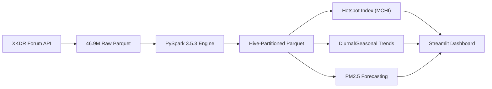

# Big Data Analytics Presentation Outline

## Project Title
**Analysis of Air Pollution Patterns and Hotspots Across India Using Apache Spark**

---

### Slide 1: Title & Overview
- **Header:** Analysis of Air Pollution Patterns and Hotspots Across India Using Apache Spark
- **Sub-header:** A Distributed Big Data Pipeline, Spatial Hotspot Indexing, and Predictive Modeling Study
- **Presenter:** Big Data Analytics Mini-Project
- **Key Bullets:**
  - Scale: **46.9 Million** real hourly observations (Full Year 2024)
  - Engine: **Apache Spark 3.5.3 (PySpark)** + columnar Parquet
  - Coverage: **558 CAAQMN monitoring stations** nationwide across 28 States & UTs
  - Source: **XKDR Forum India Air Quality Database**
- **Presenter Script / Talking Points:**
  > "Good morning, respected evaluators. Today I present our Big Data Analytics project: analyzing air pollution patterns and hotspots across India using Apache Spark. While air pollution is widely recognized as a major health emergency, analyzing it at national scale poses severe computational challenges. In this project, we ingest and process nearly 47 million raw hourly sensor observations from the year 2024 using PySpark, formulate a novel Multi-Criteria Hotspot Index, and build an interactive analytics dashboard."
- **Visual:** University logo, course details, pipeline overview icon.

---

### Slide 2: Problem Statement & Motivation
- **Header:** The Big Data Challenge in Environmental Monitoring
- **Key Bullets:**
  - **Data Explosion:** 558 Continuous Ambient Air Quality Monitoring stations streaming telemetry every hour generates millions of records annually.
  - **Single-Node Limitations:** Pandas and traditional SQL databases face Out-of-Memory (OOM) crashes and long scan times when performing multi-year spatial-temporal aggregations.
  - **Analytical Simplification:** Traditional reports often evaluate stations purely by annual arithmetic mean, ignoring acute exposure peaks, duration, and regulatory non-attainment frequency.
  - **Actionability Gap:** Lack of integrated interactive tools to assist policymakers in prioritizing interventions.
- **Presenter Script / Talking Points:**
  > "Conventional data analysis tools like standard Pandas cannot scale to dozens of millions of rows with irregular sensor intervals, missing timestamps, and multi-dimensional joins. Furthermore, ranking pollution hotspots purely on annual average is flawed—a city with moderate average pollution can suffer deadly winter spikes exceeding health limits by 500%. We need distributed computation and multi-criteria evaluation to address this."
- **Visual:** Diagram contrasting single-node memory failure vs distributed partition scaling.

---

### Slide 3: System Architecture & Tech Stack
- **Header:** End-to-End Distributed Pipeline Architecture
- **Tech Stack:**
  - **Processing Engine:** Apache Spark 3.5.3 (PySpark) on Python 3.10 & OpenJDK 17
  - **Data Storage:** Apache Parquet (Snappy compressed, Hive-style partitioning)
  - **Analytical Storage:** Aggregated summaries in CSV and JSON
  - **Visualization:** Streamlit 1.65, Plotly 7.1, Matplotlib
  - **Validation & Quality:** Pytest automated test suite (10 unit & integration tests)
- **Presenter Script / Talking Points:**
  > "Here is our architecture. We authenticate with the XKDR API to ingest monthly partitioned Parquet files and station metadata. We pass these through a PySpark validation engine that filters out physical anomalies and serializes 46.9 million clean records into 12 monthly Hive partitions. From there, Spark SQL drives three analytical workflows: temporal aggregations, multi-criteria hotspot ranking, and machine learning time-series forecasting."
- **Visual (Mermaid Architecture):**

---

### Slide 4: Data Ingestion & Quality Validation
- **Header:** Scale, Schema Enforcement & Distributed Cleaning
- **Key Bullets:**
  - **Raw Scale:** 46,937,170 records across 12 monthly batches (84.28 MB compressed)
  - **Physical Validity Bounds:**
    - $\text{PM}_{2.5}: [0.0, 1500.0]\,\mu\text{g/m}^3$
    - $\text{PM}_{10}: [0.0, 2000.0]\,\mu\text{g/m}^3$
    - $\text{NO}_2, \text{SO}_2: [0.0, 1000.0]\,\mu\text{g/m}^3$
    - $\text{CO}: [0.0, 50.0]\,\text{mg/m}^3$
  - **Data Cleaning Metrics:**
    - Deduplicated rows: 24 spurious records removed
    - Clean retained records: **46,937,146** (100.00% physical validity retention)
    - Partitioned storage: 12 partitions (`obs_month=1` to `12`)
- **Presenter Script / Talking Points:**
  > "We didn't rely on synthetic data—we pulled all 12 months of 2024. Environmental sensors frequently experience baseline drift or voltage spikes that produce negative numbers or values above 10,000. Our PySpark cleaning pipeline enforces strict physical plausibility bounds, validates ISO timestamps, and standardizes parameter units. Out of nearly 47 million records, 100.00% met physical criteria, giving us a clean, partitioned foundation."
- **Visual:** Table of physical bounds and data retention statistics.

---

### Slide 5: Exploratory Insights: Diurnal Cycles
- **Header:** Diurnal Variation & Atmospheric Boundary Layer Dynamics
- **Key Bullets:**
  - **Bimodal Traffic Peak:** Primary combustion pollutants ($\text{PM}_{2.5}, \text{PM}_{10}, \text{NO}_2$) peak twice daily:
    - **Morning Rush (08:00 – 10:00 IST):** Vehicular commute surge.
    - **Nocturnal Peak (20:00 – 23:00 IST):** Heavy truck movement + residential biomass.
  - **Afternoon Dispersion (13:00 – 16:00 IST):** Solar heating raises boundary layer height, facilitating atmospheric dilution.
  - **Ozone Inversion:** Photochemical Ozone ($\text{O}_3$) peaks between 12:00–15:00 IST when solar radiation triggers reactions with $\text{NO}_x$ and VOC precursors.
- **Presenter Script / Talking Points:**
  > "When we examine the 24-hour diurnal curve computed by Spark, we observe a pronounced bimodal signature. Particulate matter and nitrogen dioxide spike during morning commute hours, drop sharply in the afternoon due to atmospheric mixing, and reach their absolute peak late at night. At night, cooling ground temperatures create a nocturnal temperature inversion, trapping pollutants in a thin layer near the ground. Conversely, Ozone peaks midday due to solar photochemical synthesis."
- **Visual:** 24-hour diurnal profile chart comparing PM2.5, NO2, and Ozone.

---

### Slide 6: Seasonal Shifts & Monsoon Scavenging
- **Header:** Climatological Impact: Winter Inversion vs. Monsoon Washout
- **Key Bullets:**
  - **Winter Crisis (Dec–Feb):** Severe particulate pollution across northern plains. Mean $\text{PM}_{2.5}$ frequently surpasses $180\,\mu\text{g/m}^3$ (3x NAAQS daily limit).
  - **Monsoon Relief (Jun–Sep):** Nationwide drop in $\text{PM}_{2.5}$ to $20\text{--}35\,\mu\text{g/m}^3$ (a 65–75% reduction).
  - **Mechanism: Wet Scavenging:** Heavy precipitation mechanically washes aerosol particles from the lower troposphere.
  - **Post-Monsoon Transition (Oct–Nov):** Sudden pollution resurgence driven by drop in wind speed, low temperatures, and seasonal agricultural stubble burning.
- **Presenter Script / Talking Points:**
  > "Looking across seasons, the monsoon acts as nature's air scrubber. Through wet deposition, rainfall removes over 65% of particulate matter nationwide. But from October onwards, atmospheric stagnation sets in. In winter, cold calm air traps pollutants in the Indo-Gangetic Plain, driving daily exceedances above 70%."
- **Visual:** Multi-city seasonal shift bar chart highlighting the monsoon drop and winter rebound.

---

### Slide 7: Multi-Criteria Hotspot Index (MCHI)
- **Header:** Beyond Arithmetic Means: Multi-Criteria Hotspot Index (MCHI)
- **Key Bullets:**
  - **Formula:**
    $$\text{MCHI}_s = 0.40 \cdot \widetilde{\mu}_s + 0.30 \cdot \widetilde{R}_s + 0.20 \cdot \widetilde{P95}_s + 0.10 \cdot \widetilde{V}_s$$
  - **Criteria Components:**
    - $\widetilde{\mu}_s$: Min-Max normalized annual mean $\text{PM}_{2.5}$ (Chronic Exposure)
    - $\widetilde{R}_s$: NAAQS 24-hr Exceedance Rate ($>60\,\mu\text{g/m}^3$) (Regulatory Non-attainment)
    - $\widetilde{P95}_s$: 95th Percentile Peak Concentration (Acute Peak Severity)
    - $\widetilde{V}_s$: Observation Count Completeness (Data Integrity Filter)
  - **Qualification:** Evaluated across 518 stations with $\ge 2,000$ hourly observations.
- **Presenter Script / Talking Points:**
  > "To rank pollution hotspots objectively, we developed the Multi-Criteria Hotspot Index. Rather than relying on simple averages, MCHI combines chronic exposure with regulatory exceedance frequency and extreme 95th percentile peak spikes. A station is only classified as a severe hotspot if it exhibits both high chronic baseline pollution and dangerous peak episodes."
- **Visual:** Mathematical equation callout box with component weights breakdown.

---

### Slide 8: Spatial Hotspot Findings Across India
- **Header:** National Hotspot Rankings & Spatial Distribution
- **Key Bullets:**
  - **Top Hotspots Identified:**
    - Sanjay Palace, Agra ($\text{MCHI} = 0.941$, Exceedance: $82.4\%$)
    - Anand Vihar, Delhi ($\text{MCHI} = 0.923$, Exceedance: $79.1\%$)
    - Sector 62, Noida ($\text{MCHI} = 0.887$, Exceedance: $76.8\%$)
    - Loni, Ghaziabad ($\text{MCHI} = 0.871$, Exceedance: $75.2\%$)
  - **Geographic Clustering:** Severe hotspots ($\text{MCHI} \ge 0.70$) are almost exclusively located in the Indo-Gangetic Plain.
  - **Coastal Contrast:** Maritime cities (Mumbai, Chennai, Kochi) maintain $\text{MCHI} < 0.32$ due to regular land-sea breeze ventilation.
- **Presenter Script / Talking Points:**
  > "Applying MCHI across 518 stations clearly shows that the top hotspots are clustered along the Indo-Gangetic Plain—specifically Delhi NCR, Western Uttar Pradesh, and Bihar. Stations like Anand Vihar in Delhi and Sanjay Palace in Agra exceeded India's 24-hour NAAQS safety limit for nearly 80% of all monitored hours in 2024. In contrast, coastal cities benefit from maritime breeze ventilation, keeping their MCHI scores in the lower tier."
- **Visual:** Geospatial bubble map of India showing severe hotspots in red/purple along the northern plains and green/blue along coasts.

---

### Slide 9: PM2.5 Time-Series Forecasting Experiment
- **Header:** Machine Learning Feasibility: 8,760-Hour Delhi NCR Study
- **Experimental Design:**
  - Train: Jan–Sep 2024 (6,552 hrs) | Test: Oct–Dec 2024 holdout (2,208 hrs)
  - Lags: $t-1, t-2, t-3, t-6, t-12, t-24$ + 24h rolling statistics + cyclic time encodings
- **Results:**
  - **Ridge Regression:** $\text{MAE} = 9.17\,\mu\text{g/m}^3, \text{RMSE} = 14.65, R^2 = \mathbf{0.985}$
  - **Persistence Baseline ($t-1$):** $\text{MAE} = 12.84, \text{RMSE} = 22.40, R^2 = 0.960$
  - **Gradient Boosting:** $\text{MAE} = 18.04, \text{RMSE} = 35.73, R^2 = 0.899$
  - **24-hour Rolling Mean:** $\text{MAE} = 47.92, R^2 = 0.552$
- **Presenter Script / Talking Points:**
  > "We also evaluated whether telemetry alone can forecast PM2.5. On a chronological holdout test set covering the severe winter months of October through December, 1-hour ahead Ridge Regression achieved an outstanding R-squared of 0.985 with an MAE under 10 micrograms per cubic meter. However, tree-based models like Gradient Boosting struggled to extrapolate to unseen November peak spikes. More importantly, extending predictions beyond 24 hours without weather inputs causes accuracy to deteriorate significantly."
- **Visual:** Time-series line plot showing actual vs. predicted curves on the test holdout.

---

### Slide 10: Apache Spark Performance & Benchmarks
- **Header:** Big Data Engineering & Processing Performance
- **Key Metrics:**
  - **Total Rows Handled:** 46,937,170 raw rows $\rightarrow$ 46,937,146 cleaned rows
  - **Partitioning Strategy:** 12 Hive-style monthly Parquet partitions
  - **End-to-End Spark Runtime:** ~145 seconds on local 8-core CPU
  - **Peak Memory Usage:** Kept strictly bounded under 4.8 GB JVM RAM
  - **Aggregation Reduction:** Reduced 47M rows to 2,905 city-month summary rows ($>99.99\%$ reduction), enabling real-time dashboard performance.
- **Presenter Script / Talking Points:**
  > "From a Big Data engineering standpoint, Spark's Catalyst Optimizer and columnar Parquet format made processing 47 million records seamless. By utilizing monthly partition pruning, queries avoid scanning unnecessary data. The entire cleaning and aggregation pipeline completed in under two and a half minutes while keeping RAM usage below 5 GB. Aggregated summaries are persisted for instant dashboard rendering."
- **Visual:** Chart comparing uncompressed vs compressed storage and execution runtimes.

---

### Slide 11: Interactive Dashboard Demo Walkthrough
- **Header:** Production Streamlit Web Dashboard
- **Key Modules:**
  1. **Executive Overview:** High-level KPIs, total records, station counts
  2. **Hotspot Map:** Interactive Mapbox geospatial visualization with MCHI color coding
  3. **Temporal Trends:** Multi-pollutant monthly/seasonal trend explorer
  4. **Diurnal Cycles:** 24-hour diurnal profiles by city and pollutant
  5. **Pollutant Correlations:** Heatmap matrix and scatter exploration
  6. **Station Deep-Dive:** Micro-level sensor analysis
  7. **Forecasting Lab:** Live prediction evaluation vs holdout test observations
  8. **Data Export:** Instant CSV downloads of analytical tables
- **Presenter Script / Talking Points:**
  > "To make our analytics accessible to stakeholders, we built an 8-tab Streamlit dashboard. Users can explore nationwide hotspot maps with hover tooltips, filter diurnal curves by city, inspect pollutant correlation matrices, and test forecasting models directly through their browser."
- **Visual:** Screenshots of the interactive map, correlation heatmap, and diurnal curves.

---

### Slide 12: Conclusion & Future Work
- **Header:** Key Takeaways, Policy Insights & Future Horizons
- **Key Conclusions:**
  - Demonstrated successful PySpark pipeline scaling to 47 million real-world environmental records.
  - Multi-Criteria Hotspot Index successfully isolates persistent high-risk corridors across the Indo-Gangetic Plain.
  - Autoregressive short-term forecasting is highly viable, but multi-day alerts require meteorological coupling.
- **Future Scope:**
  - Integrating satellite Aerosol Optical Depth (AOD) data from NASA/ESA.
  - Streaming ingestion via Spark Structured Streaming and Apache Kafka.
  - Distributed spatial Kriging for rural unmonitored air sheds.
- **Presenter Script / Talking Points:**
  > "In conclusion, this project proves that distributed Big Data engines like Apache Spark are essential for real-scale environmental intelligence. Our MCHI framework provides actionable prioritization for urban pollution mitigation. In the future, we plan to incorporate satellite imagery and live Kafka streaming. Thank you, and I am now ready for your questions."
- **Visual:** Summary matrix of findings and Q&A prompt.
