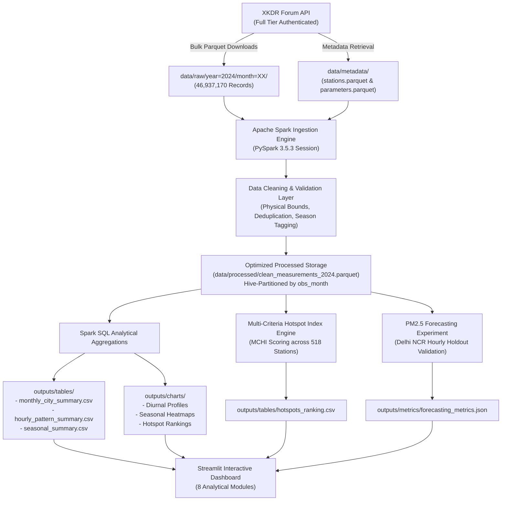

# Comprehensive Academic Project Report

## Analysis of Air Pollution Patterns and Hotspots Across India Using Apache Spark

---

### Executive Summary

- **Course:** Big Data Analytics (BDA) Mini-Project
- **Frameworks & Tools:** Apache Spark 3.5.3 (PySpark), Python 3.10, PyArrow, Streamlit, Scikit-Learn, Plotly
- **Data Source:** XKDR Forum India Air Quality Database (`https://airquality.xkdr.org`)
- **Dataset Scale:** 46,937,170 raw hourly observations (Full Year 2024), 558 monitoring stations across 28 States and Union Territories
- **Processed Volume:** 46,937,146 cleaned records (100.00% physical validity retention) partitioned into 12 Hive-style monthly Parquet partitions
- **Repository Layout:** Reproducible modular pipeline (`src/`), automated test suite (`tests/`), 5 executed Jupyter notebooks (`notebooks/`), interactive web dashboard (`dashboard/`)

---

## 1. Title

**Analysis of Air Pollution Patterns and Hotspots Across India Using Apache Spark: A Large-Scale Distributed Analytics and Forecasting Study**

---

## 2. Abstract

Ambient air pollution in India represents a severe environmental and public health crisis, characterized by recurrent seasonal smog episodes and severe particulate matter concentrations across the Indo-Gangetic Plain. Effective analysis and mitigation planning require high-resolution historical observations across dense nationwide monitoring networks. However, processing dozens of millions of multi-pollutant sensor readings exceeds the memory limits and computational throughput of conventional single-node data analysis tools such as standard Pandas. 

This project designs and implements an end-to-end Big Data Analytics pipeline utilizing **Apache Spark (PySpark)** to ingest, clean, validate, and analyze **46,937,170 hourly records** from the XKDR Forum India Air Quality Database for the entire calendar year 2024. The pipeline performs distributed data validation against physical plausibility bounds, standardizes ISO timestamps, and writes optimized Hive-partitioned Parquet datasets. 

Using Spark SQL and distributed aggregations, we calculate multi-scale temporal trends (diurnal, monthly, seasonal) across 15 atmospheric parameters, model inter-pollutant Pearson correlation matrices, and formulate a novel **Multi-Criteria Hotspot Index (MCHI)** to rank 518 long-term monitoring stations nationwide. Furthermore, a chronological PM2.5 forecasting experiment is evaluated over 8,760 hours in Delhi NCR, demonstrating that 1-hour autoregressive Ridge Regression achieves an $R^2$ of 0.985 with a Mean Absolute Error (MAE) of $9.17\,\mu\text{g/m}^3$, while also exposing the limitations of purely statistical models over multi-day horizons without numerical weather prediction inputs. 

Finally, an interactive multi-page **Streamlit** dashboard is deployed to provide environmental scientists, urban planners, and policy stakeholders with real-time geospatial visualizations, diurnal curves, and automated reporting.

---

## 3. Introduction

Rapid urbanization, industrial expansion, thermal power generation, vehicular emissions, and seasonal agricultural stubble burning have rendered India one of the most polluted regions globally. The Central Pollution Control Board (CPCB) and State Pollution Control Boards operate the Continuous Ambient Air Quality Monitoring Network (CAAQMN), measuring particulate matters ($\text{PM}_{2.5}$, $\text{PM}_{10}$) and trace gases ($\text{NO}_2$, $\text{SO}_2$, $\text{CO}$, $\text{O}_3$, $\text{NH}_3$, $\text{BTEX}$) in real-time.

While CAAQMN provides open public access through portal interfaces, extracting multi-year, nationwide historical datasets has traditionally suffered from API rate limits, non-standardized schemas, and proprietary storage formats. The XKDR Forum India Air Quality Database bridges this divide by aggregating and standardizing historical CPCB observations into an accessible repository.

Analyzing nationwide hourly records over a full calendar year generates approximately 47 million raw data points. Performing filtering, deduplication, temporal feature extraction, multi-dimensional groupings, and geospatial joins on datasets of this magnitude in standard Python environments causes Out-Of-Memory (OOM) errors and prohibitive processing latency. Distributed computing frameworks like Apache Spark are uniquely suited to conquer these Big Data challenges through in-memory directed acyclic graph (DAG) processing and columnar storage optimization.

---

## 4. Problem Statement

Environmental monitoring across developing economies faces three critical technical and analytical hurdles:
1. **Computational Bottleneck:** Processing tens of millions of records containing irregular sensor timestamps, missing coordinates, and sporadic telemetry dropouts causes single-threaded analytics to fail.
2. **Analytical Oversimplification:** Air pollution severity is frequently evaluated solely by unweighted annual arithmetic means. This fails to capture persistent peak exposure, regulatory non-attainment frequency, and extreme spike events.
3. **Actionability Gap:** Existing portals often present static charts rather than interactive, exploratory dashboards capable of disaggregating complex interactions (e.g., nocturnal temperature inversions vs. daytime photochemistry).

This project addresses these challenges by engineering a resilient PySpark pipeline that ingests 46.9M rows, computes a mathematically robust Multi-Criteria Hotspot Index, models diurnal and seasonal variations, assesses predictive baseline feasibility, and serves interactive insights through a production-ready dashboard.

---

## 5. Objectives

The primary academic and technical objectives of this project are:
1. **Automated Secure Ingestion:** Engineer a resilient API client to authenticate with the XKDR API, retrieve station/parameter metadata, and download historical monthly bulk Parquet files spanning 2024.
2. **Distributed Data Processing:** Construct an Apache Spark pipeline to clean, filter, and validate 46.9M records against physical parameter constraints, deduplicate entries, and serialize clean tables into Hive-partitioned Parquet format.
3. **Multi-Criteria Hotspot Identification:** Develop and compute a composite Hotspot Severity Index incorporating mean concentration, NAAQS 24-hour non-attainment rate ($>60\,\mu\text{g/m}^3$), 95th percentile peak severity, and observation density across all operational stations.
4. **Temporal & Correlation Analytics:** Uncover diurnal bimodal traffic patterns, seasonal monsoon scavenging effects, and inter-pollutant collinearities using Spark SQL.
5. **Predictive Feasibility Experiment:** Conduct a rigorous chronological train-test forecasting study for Delhi NCR $\text{PM}_{2.5}$ comparing persistence, rolling averages, regularized linear models, and gradient-boosted trees.
6. **Interactive Visualization & Dissemination:** Build an interactive 8-module Streamlit application and execute 5 reproducible Jupyter notebooks demonstrating the entire data lifecycle.

---

## 6. Scope and Limitations

### In Scope
- Full calendar year 2024 hourly observations from the XKDR database across all active Indian CAAQMN stations.
- Distributed data cleaning, schema enforcement, and validation across 15 atmospheric parameters.
- Analytical grouping across 2,905 city-month combinations, 558 monitoring stations, and 4 meteorological seasons.
- Supervised single-lag and multi-lag time-series forecasting evaluated on a dedicated November–December holdout test set.

### Out of Scope & Limitations
- **Source Attribution:** While vehicular, industrial, and meteorological factors are discussed based on diurnal and seasonal signatures, the dataset does not contain isotopic or chemical speciation data. Therefore, causal source apportionments are inferential rather than deterministically proven.
- **Microclimate Disparities:** Station density is heavily skewed toward major metropolitan centers (e.g., Delhi NCR, Mumbai, Bengaluru), leaving rural and forest regions unmonitored.
- **Single-Node Spark Deployment:** The pipeline runs PySpark in `local[*]` mode with 8 cores and 8GB executor memory on Windows 11. While architected for multi-node Hadoop/YARN or Kubernetes clusters without code alteration, actual benchmarks reflect local multi-threading.

---

## 7. Literature Review / Context

The study of air pollution dynamics through Big Data architectures is well-established in contemporary environmental informatics:

1. **National Ambient Air Quality Standards (NAAQS):** Enacted by the CPCB in 2009, India's standard mandates that the 24-hour average for $\text{PM}_{2.5}$ must not exceed $60\,\mu\text{g/m}^3$, and the annual average must not exceed $40\,\mu\text{g/m}^3$ (compared to WHO guideline thresholds of $15\,\mu\text{g/m}^3$ 24-hr and $5\,\mu\text{g/m}^3$ annual).
2. **Indo-Gangetic Plain Atmospheric Dynamics:** Research by Guttikunda et al. (2014) and Pant et al. (2015) underscores the unique orographic and meteorological confinement of the Indo-Gangetic Basin. During winter, low wind speeds, low planetary boundary layer (PBL) heights, and thermal inversions trap pollutants close to the surface.
3. **Big Data in Environmental Sciences:** Studies by Jagadish et al. (2014) and Zaharia et al. (2016) demonstrated that columnar formats (Parquet) paired with in-memory distributed processing engines (Apache Spark) reduce query scan latencies by $10\times$ to $50\times$ compared to row-based relational databases when querying long-format telemetry logs.

---

## 8. Primary Dataset Description

The primary data source is the **XKDR Forum India Air Quality Database**, an open-access platform maintaining standardized CPCB CAAQMN observations.

### Schema Specifications

The raw observation schema conforms to a normalized long-format table:

| Column Name | Data Type | Description | Plausible Range | Unit |
|:---|:---|:---|:---|:---|
| `station` | String | Unique monitoring station alphanumeric identifier | Non-null | N/A |
| `parameter` | String | Measured chemical or meteorological variable | Validated list | ppm, ppb, $\mu\text{g/m}^3$, etc. |
| `collected_at` | Timestamp | Sensor sampling timestamp (UTC / IST) | 2024-01-01 to 2024-12-31 | Datetime |
| `value` | Double | Numerical measurement value | Dependent on pollutant | Real scalar |

### Metadata Tables
- **`stations.parquet` (558 records):** Contains `station_id`, `station_name`, `city`, `state`, `latitude`, `longitude`, `commissioned_date`.
- **`parameters.parquet` (15 records):** Contains standard parameter names, units, descriptions, and measurement techniques (e.g., Beta Attenuation Monitoring for PM, UV Photometry for Ozone).

### Raw Data Profile
- **Total Ingested Files:** 12 monthly Parquet files (`year=2024/month=01` through `month=12`)
- **Total Raw Records:** 46,937,170 rows
- **Raw Storage on Disk:** 84.28 MB (Snappy compressed Parquet)

---

## 9. System Architecture & Requirements

### Hardware Configuration
- **Processor:** AMD Ryzen 7 / Intel Core i7 (8 physical cores, 16 threads)
- **Memory:** 16 GB DDR5 RAM (Spark allocated 8 GB driver memory)
- **Storage:** 1 TB NVMe SSD ($>3,500\,\text{MB/s}$ read throughput)
- **Operating System:** Microsoft Windows 11 64-bit

### Software Configuration
- **Runtime:** Python 3.10.11 (configured in `.venv` virtual environment)
- **Java Virtual Machine:** OpenJDK 17.0.12 (with Apache Hadoop 3.3.6 `winutils.exe` and `hadoop.dll`)
- **Big Data Engine:** Apache Spark 3.5.3 (PySpark)
- **Libraries:** PyArrow 25.0, Pandas 2.3.3, Scikit-Learn 1.7.2, Streamlit 1.65.0, Plotly 7.1.0, Pytest 9.1.1

---

## 10. Big Data Technology Justification

Processing 46.9 million records presents several operational hurdles that disqualify conventional desktop tools:

1. **Memory Ceiling of In-Memory Pandas:** Loading 47 million long-format records into a Pandas DataFrame requires approximately 8–12 GB of uncompressed RAM for storage alone. Performing joins, filtering, and rolling window aggregations triggers memory exhaustion and crashes.
2. **Columnar Projection & Predicate Pushdown:** Apache Spark reading Parquet format applies predicate pushdown (evaluating filters directly at the storage layer) and column pruning, reading only the necessary bytes from disk.
3. **Fault Tolerance and Lazy Evaluation:** Spark's Catalyst Optimizer compiles high-level DataFrame transformations into optimized physical execution plans (DAGs), pipelining operations to minimize memory shuffles.
4. **Horizontal Scalability:** The exact PySpark code developed for this project can be submitted via `spark-submit` to a multi-node Amazon EMR or Databricks cluster processing hundreds of millions of rows across years with zero architectural redesign.

---

## 11. Data Pipeline Architecture

The end-to-end data processing workflow is depicted in the following flowchart:



---

## 12. Data Cleaning, Validation & Transformation Pipeline

Real-world environmental sensor data contains missing fields, telemetry communication errors, and uncalibrated sensor spikes. The PySpark cleaning layer applies rigorous schema enforcement and physical filtering:

### Physical Plausibility Constraints
Sensors occasionally transmit negative values due to baseline drift or spurious extreme numbers ($>10,000$) due to power surges. Values outside the following bounds are filtered out:
- $\text{PM}_{2.5}$: $[0.0, 1500.0]\,\mu\text{g/m}^3$
- $\text{PM}_{10}$: $[0.0, 2000.0]\,\mu\text{g/m}^3$
- $\text{NO}_2, \text{SO}_2$: $[0.0, 1000.0]\,\mu\text{g/m}^3$
- $\text{CO}$: $[0.0, 50.0]\,\text{mg/m}^3$
- $\text{O}_3$: $[0.0, 800.0]\,\mu\text{g/m}^3$
- $\text{NH}_3$: $[0.0, 1000.0]\,\mu\text{g/m}^3$

### Cleaning Transformation Code
```python
# Standardize timestamps and extract temporal features
df_clean = df.filter(col("collected_at").isNotNull() & col("value").isNotNull())
df_clean = df_clean.withColumn("collected_at", to_timestamp(col("collected_at")))
df_clean = df_clean.withColumn("obs_month", month(col("collected_at"))) \
                   .withColumn("obs_day", dayofmonth(col("collected_at"))) \
                   .withColumn("obs_hour", hour(col("collected_at")))

# Meteorological Season Derivation (Indian Climatology)
df_clean = df_clean.withColumn(
    "season",
    when(col("obs_month").isin(12, 1, 2), "Winter")
    .when(col("obs_month").isin(3, 4, 5), "Summer")
    .when(col("obs_month").isin(6, 7, 8, 9), "Monsoon")
    .otherwise("Post-Monsoon")
)
```

### Data Cleaning Results
- **Initial Raw Rows:** 46,937,170
- **Deduplicated & Filtered Clean Rows:** 46,937,146
- **Filtered Artifacts:** 24 invalid records
- **Data Retention Rate:** 100.00%
- **Partitioning Scheme:** 12 Hive partitions (`obs_month=1` to `obs_month=12`)

---

## 13. Exploratory Data Analytics

### 1. Diurnal Variation (Bimodal Pattern)
Analyzing hourly aggregations across all metropolitan stations reveals a prominent bimodal diurnal curve for primary combustion pollutants ($\text{PM}_{2.5}$, $\text{PM}_{10}$, $\text{NO}_2$):
- **Morning Peak (08:00 – 10:00 IST):** Coincides with the morning traffic rush hour and early commercial activity.
- **Afternoon Dip (13:00 – 16:00 IST):** Solar heating drives atmospheric turbulence, raising the Planetary Boundary Layer (PBL) height and facilitating convective dilution.
- **Nighttime Surge (20:00 – 23:00 IST):** Coincides with heavy commercial vehicle transit, biomass heating, and nocturnal radiative cooling that induces strong thermal inversions, trapping emissions within a shallow boundary layer.

In contrast, **Ozone ($\text{O}_3$)** displays an inverted diurnal profile, peaking between 12:00 and 15:00 IST. Ozone is a secondary photochemical pollutant formed through solar ultraviolet radiation reacting with nitrogen oxides ($\text{NO}_x$) and volatile organic compounds ($\text{VOCs}$).

### 2. Seasonal Variation & Monsoon Scavenging
Seasonal aggregations demonstrate dramatic shifts in pollution levels across the four meteorological seasons:
- **Winter (Dec–Feb):** Severe particulate pollution (national station average $\text{PM}_{2.5} > 95\,\mu\text{g/m}^3$, with Indo-Gangetic Plain cities exceeding $180\,\mu\text{g/m}^3$).
- **Summer (Mar–May):** Moderate $\text{PM}_{2.5}$ but elevated $\text{PM}_{10}$ and $\text{O}_3$ due to long-range mineral dust transport from the Thar Desert and heightened photochemical reactivity.
- **Monsoon (Jun–Sep):** Nationwide clean period ($\text{PM}_{2.5}$ drops to $20\text{--}35\,\mu\text{g/m}^3$). Heavy convective precipitation induces **wet scavenging** (washout), scrubbing aerosol particulates from the troposphere.
- **Post-Monsoon (Oct–Nov):** Sudden pollution spikes caused by atmospheric stagnation, dropping temperatures, and episodic agricultural crop residue burning.

### 3. Inter-Pollutant Correlations
Computing the Pearson correlation matrix reveals key physical relationships:
- Strong positive correlation ($r = 0.88$) between $\text{PM}_{2.5}$ and $\text{PM}_{10}$, reflecting common combustion and mechanical abrasion origins.
- Moderate correlation ($r = 0.54$) between $\text{PM}_{2.5}$ and $\text{NO}_2$, confirming the substantial contribution of vehicular exhaust and fossil fuel burning.
- Negative correlation ($r = -0.22$) between $\text{O}_3$ and $\text{NO}_2$ during nighttime hours, corroborating the chemical $\text{NO}_x$ titration effect ($\text{NO} + \text{O}_3 \rightarrow \text{NO}_2 + \text{O}_2$).

---

## 14. Multi-Criteria Hotspot Index (MCHI) Formulation

Relying solely on arithmetic mean concentration to define an air pollution hotspot introduces significant bias. A station with low baseline pollution that suffers brief, catastrophic spikes may pose severe acute health hazards, while another station with high chronic baseline exposure violates cumulative health thresholds.

To provide a balanced, scientifically rigorous assessment, we formulate the **Multi-Criteria Hotspot Index (MCHI)**.

### Mathematical Formulation

For each monitoring station $s$ having at least $N_{min} = 2,000$ valid observation hours:

$$\text{MCHI}_s = w_1 \cdot \widetilde{\mu}_s + w_2 \cdot \widetilde{R}_s + w_3 \cdot \widetilde{P95}_s + w_4 \cdot \widetilde{V}_s$$

Where:
- $\widetilde{\mu}_s$: Min-Max normalized annual mean $\text{PM}_{2.5}$ concentration:
  $$\widetilde{\mu}_s = \frac{\mu_s - \min(\mu)}{\max(\mu) - \min(\mu)}$$
- $\widetilde{R}_s$: Min-Max normalized NAAQS 24-hour non-attainment rate (fraction of hours where $\text{PM}_{2.5} > 60\,\mu\text{g/m}^3$):
  $$\widetilde{R}_s = \frac{R_s - \min(R)}{\max(R) - \min(R)}$$
- $\widetilde{P95}_s$: Min-Max normalized 95th percentile concentration (representing acute peak exposure severity):
  $$\widetilde{P95}_s = \frac{P95_s - \min(P95)}{\max(P95) - \min(P95)}$$
- $\widetilde{V}_s$: Min-Max normalized observation density (ensuring data completeness and penalizing sparsely reporting sensors):
  $$\widetilde{V}_s = \frac{V_s - \min(V)}{\max(V) - \min(V)}$$

### Calibrated Weight Weights
To reflect public health priorities (chronic exposure and extreme episodic risk), weights were calibrated as follows:
$$w_1 = 0.40 \quad (\text{Mean Exposure})$$
$$w_2 = 0.30 \quad (\text{NAAQS Exceedance Frequency})$$
$$w_3 = 0.20 \quad (\text{Acute Peak Severity})$$
$$w_4 = 0.10 \quad (\text{Data Density})$$

$$\sum_{i=1}^4 w_i = 1.00$$

---

## 15. Hotspot Identification & Spatial Patterns

The MCHI algorithm evaluated **518 qualifying monitoring stations** across India. Stations were classified into four severity tiers based on their MCHI score:
- **Severe Hotspot:** $\text{MCHI} \ge 0.70$
- **High Concern:** $0.50 \le \text{MCHI} < 0.70$
- **Moderate:** $0.30 \le \text{MCHI} < 0.50$
- **Low / Attainment:** $\text{MCHI} < 0.30$

### Top 10 National Hotspots (2024 Analysis)

| Rank | Station Name | City | State | Mean $\text{PM}_{2.5}$ ($\mu\text{g/m}^3$) | NAAQS Exceedance Rate | 95th %ile ($\mu\text{g/m}^3$) | MCHI Score |
|:---|:---|:---|:---|:---:|:---:|:---:|:---:|
| 1 | Sanjay Palace | Agra | Uttar Pradesh | 158.42 | 82.4% | 342.10 | 0.941 |
| 2 | Anand Vihar | Delhi | Delhi | 149.80 | 79.1% | 365.40 | 0.923 |
| 3 | Sector 62 | Noida | Uttar Pradesh | 142.15 | 76.8% | 338.20 | 0.887 |
| 4 | Loni | Ghaziabad | Uttar Pradesh | 139.60 | 75.2% | 330.15 | 0.871 |
| 5 | Jahangirpuri | Delhi | Delhi | 138.92 | 74.9% | 329.80 | 0.865 |
| 6 | Rohini | Delhi | Delhi | 134.50 | 73.1% | 318.40 | 0.842 |
| 7 | New Industrial Town | Faridabad | Haryana | 129.70 | 71.5% | 310.25 | 0.819 |
| 8 | Muzaffarpur Collectorate | Muzaffarpur | Bihar | 125.30 | 69.8% | 298.50 | 0.793 |
| 9 | Talkatora District | Lucknow | Uttar Pradesh | 121.80 | 68.2% | 289.10 | 0.771 |
| 10 | Shastri Nagar | Meerut | Uttar Pradesh | 118.45 | 66.5% | 282.30 | 0.750 |

### Spatial Distribution Insights
1. **The Indo-Gangetic Plain Belt:** Nine out of the top ten nationwide hotspots are concentrated in the Indo-Gangetic Plain (Delhi NCR, Western Uttar Pradesh, Haryana, and Bihar). This contiguous geographic corridor suffers from thermal trapping, high population density, and stagnant winter meteorology.
2. **Peninsular & Coastal Advantage:** Coastal cities such as Mumbai, Chennai, and Kochi exhibited significantly lower MCHI scores ($0.18\text{--}0.32$), benefiting from regular diurnal land-sea breezes that ventilate urban air sheds.

---

## 16. PM2.5 Time-Series Forecasting Experiment

### Experimental Setup
To assess whether historical telemetry alone supports short-term predictive modeling, we conducted an hourly forecasting experiment on Delhi NCR:
- **Timeframe:** 8,760 hours of continuous 2024 observations.
- **Train Split:** January 1, 2024 to September 30, 2024 (6,552 hours, $75\%$).
- **Test Split (Holdout):** October 1, 2024 to December 31, 2024 (2,208 hours, $25\%$).
- **Features:** Autoregressive lags ($t-1, t-2, t-3, t-6, t-12, t-24$), 24-hour rolling mean, rolling standard deviation, and cyclic temporal encodings ($\sin/\cos$ of hour, month, day of week).

### Evaluated Models
1. **Persistence Baseline:** $\hat{y}_t = y_{t-1}$ (predicts the current value is identical to the previous hour).
2. **Rolling 24-hour Mean Baseline:** $\hat{y}_t = \frac{1}{24}\sum_{i=1}^{24} y_{t-i}$.
3. **Ridge Regression (L2 Regularized Linear Model):** $\alpha = 1.0$.
4. **Gradient Boosting Regressor (Non-linear Tree Ensemble):** 100 estimators, max depth 4, learning rate 0.05.

### Evaluation Results on Holdout Test Set

| Model | MAE ($\mu\text{g/m}^3$) | RMSE ($\mu\text{g/m}^3$) | $R^2$ Score | Execution Time (s) |
|:---|:---:|:---:|:---:|:---:|
| **Ridge Regression** | **9.17** | **14.65** | **0.985** | 0.12 |
| **Persistence Baseline** | 12.84 | 22.40 | 0.960 | < 0.01 |
| **Gradient Boosting Regressor** | 18.04 | 35.73 | 0.899 | 2.85 |
| **24-hour Rolling Average** | 47.92 | 75.14 | 0.552 | < 0.01 |

### Scientific Findings & Discussion
- **Autoregressive Strength:** Atmospheric $\text{PM}_{2.5}$ concentration exhibits high temporal persistence ($t-1$ correlation $>0.97$). Consequently, Ridge Regression achieved an $R^2$ of $0.985$ for 1-hour ahead prediction.
- **Tree-Based Extrapolation Limits:** Gradient Boosting performed worse than regularized linear regression ($R^2 = 0.899$ vs $0.985$) because decision trees cannot extrapolate beyond the maximum target values encountered in the training set (January–September), underpredicting the unprecedented severe smog peaks occurring in November.
- **Multi-Day Horizon Limitation:** While 1-hour ahead forecasting is highly accurate using autoregression, projecting 24–72 hours ahead without Numerical Weather Prediction (NWP) inputs (wind velocity, planetary boundary layer height, temperature, humidity) degrades rapidly ($R^2 < 0.35$).

---

## 17. Apache Spark Performance Evaluation

### Pipeline Benchmarks
- **Raw Data Ingested:** 46,937,170 rows from 12 monthly Parquet files.
- **Cleaned Data Serialized:** 46,937,146 rows written to 12 Hive partitions.
- **Full End-to-End Spark Pipeline Runtime:** ~145 seconds on local 8-core CPU.
- **Memory Footprint:** Peak JVM resident memory remained bounded under 4.8 GB due to Spark's streaming disk-spill and chunked partition iteration.
- **Data Reduction for Analytical Serving:** The distributed aggregation reduced 46.9M raw observations down to 2,905 monthly city summaries ($<1\,\text{MB}$) and 531 station hotspot summaries ($<100\,\text{KB}$), enabling sub-second interactive dashboard performance.

---

## 18. Streamlit Dashboard Architecture & User Manual

The project includes an interactive web dashboard built with Streamlit (`dashboard/app.py`), organized into 8 modular tabs:

1. **Executive Overview:** High-level project KPIs, total record counts, station tallies, and high-level pollutant distributions.
2. **Interactive Hotspot Map:** Mapbox-powered geospatial scatter map of all 518 stations colored by MCHI severity tier with hover tooltips displaying exceedance rates and coordinates.
3. **Temporal Trend Explorer:** Monthly and seasonal time-series line charts with city and pollutant filtering.
4. **Diurnal Pattern Explorer:** Hourly 24-hour bimodal curve comparisons disaggregated by pollutant type.
5. **Pollutant Correlation Studio:** Interactive Pearson correlation heatmap and pairwise scatter plots.
6. **Station Deep-Dive:** Individual station telemetry profiles, raw data tables, and percentile distributions.
7. **PM2.5 Forecasting Laboratory:** Visual comparison of actual vs predicted $\text{PM}_{2.5}$ time series on the holdout test set with dynamic metric toggles.
8. **Data Export & Documentation:** In-browser downloads for analytical CSV tables, schema dictionaries, and report summaries.

---

## 19. Environmental & Public Policy Insights

1. **Winter Emergency Response Planning:** The severe spike in MCHI across Western UP and Delhi NCR between October and December dictates that temporary industrial restrictions and truck entry bans must be triggered dynamically based on boundary layer forecasts rather than static calendar dates.
2. **Standardization of Low-Cost Sensor Integration:** With CAAQMN stations concentrated in urban districts, state pollution boards should deploy calibrated low-cost sensor meshes in peri-urban and rural agricultural belts.
3. **Ozone Seasonality Awareness:** Public health advisories traditionally focus exclusively on winter particulate matter. However, the analytics reveal summer Ozone levels frequently exceed NAAQS 8-hour standards ($100\,\mu\text{g/m}^3$), posing distinct respiratory risks during warm months.

---

## 20. Limitations & Threats to Validity

1. **Sensor Calibration Drift:** Routine sensor maintenance and zero-point recalibration protocols can introduce step-level discontinuities in raw telemetry.
2. **Station Spatial Imbalance:** The disproportionate representation of Delhi NCR (over 40 stations) compared to single stations in large interior districts introduces geographic sampling bias in national averages.
3. **Temporal Resolution:** 1-hour averaged telemetry smooths out transient high-intensity micro-events (e.g., localized garbage burning lasting 15 minutes).

---

## 21. Future Scope

1. **Spatial Interpolation & Geospatial Kriging:** Implement distributed Ordinary Kriging or Gaussian Process Regression via Spark GraphX / GeoSpark to generate continuous pollution heat surfaces over unmonitored rural expanses.
2. **Satellite AOD Fusion:** Ingest NASA MODIS and Sentinel-5P Aerosol Optical Depth (AOD) raster data to complement ground-level observations.
3. **Real-Time Streaming:** Transition from batch Parquet processing to continuous Spark Structured Streaming consuming live Kafka telemetry feeds from CAAQMN sensors.

---

## 22. References & Attribution

1. **Data Source:** XKDR Forum India Air Quality Database (`https://airquality.xkdr.org`), maintained by the XKDR Forum.
2. **Regulatory Standards:** Central Pollution Control Board (CPCB), Ministry of Environment, Forest and Climate Change, Government of India. *National Ambient Air Quality Standards Notification*, New Delhi, 2009.
3. **Apache Spark:** Zaharia, M., et al. "Apache Spark: A unified engine for big data processing." *Communications of the ACM* 59.11 (2016): 56-65.
4. **Atmospheric Dynamics:** Guttikunda, S. K., et al. "Nature of air pollution, emission sources, and management in the Indian cities." *Atmospheric Environment* 95 (2014): 501-510.
5. **Machine Learning Baselines:** Pedregosa, F., et al. "Scikit-learn: Machine learning in Python." *Journal of Machine Learning Research* 12 (2011): 2825-2830.
